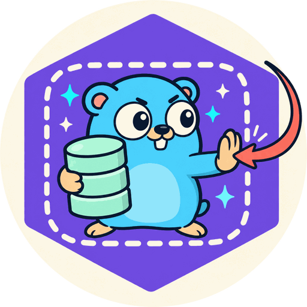

<div align="center">
  
  <h1>txbypass</h1>

  [](https://github.com/mpyw/txbypass/actions/workflows/ci.yml)
  [](https://codecov.io/gh/mpyw/txbypass)
  [](https://pkg.go.dev/github.com/mpyw/txbypass)
</div>

Go linter that reports a database handle used inside a transaction it opened.

## Overview

```go
package app

import (
	"context"

	"gorm.io/gorm"
)

func (r *OrderRepo) Place(
	ctx context.Context,
	o *Order,
) error {
	return r.db.WithContext(ctx).Transaction(
		func(tx *gorm.DB) error {
			if err := tx.Create(o).Error; err != nil {
				return err
			}
			log := &AuditLog{OrderID: o.ID}
			return r.db.Create(log).Error
		},
	)
}
```

```console
$ txbypass ./...
order.go:19:11: r.db bypasses the transaction opened with Transaction; use tx instead [outer-handle]
```

The callback receives the transaction as `tx`. `r.db` is the pool the transaction came from, so the audit log is written outside the transaction.

| What goes wrong | Why |
| --- | --- |
| The write survives a rollback | It was never part of the transaction |
| The write can wait forever | It runs on another connection, and may need a lock the transaction holds |
| The write cannot see the transaction's rows | They are not committed yet |

The code compiles. A test where nothing fails passes too. txbypass finds it from the source.

Every report of a rule ends with the rule's name. That name is what `//txbypass:ignore` takes. A report about a directive itself names no rule, and no ignore silences it.

## Install

| Method | Command | Needs |
| --- | --- | --- |
| **[mise](https://mise.jdx.dev/)** *(recommended)* | `mise use "github:mpyw/txbypass@0.1.0"` | Nothing. Installs the prebuilt binary |
| `go tool` | `go get -tool github.com/mpyw/txbypass/cmd/txbypass@latest` | Go 1.27+ |
| `go install` | `go install github.com/mpyw/txbypass/cmd/txbypass@latest` | Go 1.27+ |
| Release archive | See below | Nothing |

```bash
txbypass ./...
txbypass -V=full   # the release this binary was built from
```

<details>
<summary>Pin a version, run through <code>go vet</code> or golangci-lint, or install from an archive</summary>

`mise use` pins the version in the project's `mise.toml`, so every checkout and CI run the same one. Add `-g` to install it for every project on your machine instead.

```toml
[tools]
"github:mpyw/txbypass" = "0.1.0"
```

As a tool dependency in `go.mod`:

```bash
go get -tool github.com/mpyw/txbypass/cmd/txbypass@latest
go tool txbypass ./...
```

Through `go vet`, which runs it with the same package loading as the rest of your vet checks, and caches it:

```bash
go vet -vettool=$(which txbypass) ./...
```

Without installing anything:

```bash
go run github.com/mpyw/txbypass/cmd/txbypass@latest ./...
```

From a release archive, verified against the published checksums:

```bash
VERSION=0.1.0
REPO=https://github.com/mpyw/txbypass
BASE="${REPO}/releases/download/v${VERSION}"
curl -LO "${BASE}/txbypass_${VERSION}_darwin_arm64.tar.gz"
curl -LO "${BASE}/checksums.txt"
shasum -a 256 -c checksums.txt --ignore-missing
tar xzf "txbypass_${VERSION}_darwin_arm64.tar.gz"
```

Inside golangci-lint, as a [module plugin](https://golangci-lint.run/plugins/module-plugins/). txbypass is not bundled with golangci-lint, so build a binary that holds it. Write `.custom-gcl.yml`:

```yaml
version: v2.13.1  # the golangci-lint release to build
plugins:
  - module: github.com/mpyw/txbypass
    import: github.com/mpyw/txbypass/plugin
    version: v0.1.0
```

Turn it on in `.golangci.yml`. Each key under `settings` is a rule's name, as the flags take it. A rule left out keeps its default. An unknown name stops the run:

```yaml
version: "2"
linters:
  enable:
    - txbypass
  settings:
    custom:
      txbypass:
        type: module
        description: Transaction bypass linter
        settings:
          outer-handle: true
```

Then build and run it:

```bash
golangci-lint custom  # writes ./custom-gcl
./custom-gcl run ./...
```

</details>

## Rules

| Rule | Default | Reports |
| --- | --- | --- |
| [`outer-handle`](#outer-handle) | 🟢 On | The handle a transaction was opened on, used while the transaction is open<br>→ Use the transaction |
| [`outer-context`](#outer-context) | 🟢 On | The outer context, used inside a callback whose context carries the transaction<br>→ Use the callback's context |

Each rule has a flag of its name:

```bash
# every rule except outer-context
txbypass -outer-context=false ./...
```

Nothing is reported in a generated file. Test files are checked like any other file.

### Supported libraries

An invoker opens a transaction and invokes a callback inside it. A begin returns the transaction, which stays open until it is committed or rolled back.

| Library | Invoker | Begin ... Commit |
| --- | --- | --- |
| [database/sql](https://pkg.go.dev/database/sql) |  | [`DB.Begin`](https://pkg.go.dev/database/sql#DB.Begin), [`DB.BeginTx`](https://pkg.go.dev/database/sql#DB.BeginTx) |
| [sqlx](https://pkg.go.dev/github.com/jmoiron/sqlx) |  | [`DB.Beginx`](https://pkg.go.dev/github.com/jmoiron/sqlx#DB.Beginx), [`DB.BeginTxx`](https://pkg.go.dev/github.com/jmoiron/sqlx#DB.BeginTxx), [`DB.MustBegin`](https://pkg.go.dev/github.com/jmoiron/sqlx#DB.MustBegin), [`DB.MustBeginTx`](https://pkg.go.dev/github.com/jmoiron/sqlx#DB.MustBeginTx) |
| [pgx](https://pkg.go.dev/github.com/jackc/pgx/v5) v5 | [`BeginFunc`](https://pkg.go.dev/github.com/jackc/pgx/v5#BeginFunc), [`BeginTxFunc`](https://pkg.go.dev/github.com/jackc/pgx/v5#BeginTxFunc) | [`Tx.Begin`](https://pkg.go.dev/github.com/jackc/pgx/v5#Tx.Begin), [`pgxpool.Pool.Begin`](https://pkg.go.dev/github.com/jackc/pgx/v5/pgxpool#Pool.Begin), [`pgxpool.Pool.BeginTx`](https://pkg.go.dev/github.com/jackc/pgx/v5/pgxpool#Pool.BeginTx) |
| [pgx](https://pkg.go.dev/github.com/jackc/pgx/v4) v4 | [`Tx.BeginFunc`](https://pkg.go.dev/github.com/jackc/pgx/v4#Tx.BeginFunc), [`pgxpool.Pool.BeginFunc`](https://pkg.go.dev/github.com/jackc/pgx/v4/pgxpool#Pool.BeginFunc), [`pgxpool.Pool.BeginTxFunc`](https://pkg.go.dev/github.com/jackc/pgx/v4/pgxpool#Pool.BeginTxFunc) | [`Tx.Begin`](https://pkg.go.dev/github.com/jackc/pgx/v4#Tx.Begin), [`pgxpool.Pool.Begin`](https://pkg.go.dev/github.com/jackc/pgx/v4/pgxpool#Pool.Begin), [`pgxpool.Pool.BeginTx`](https://pkg.go.dev/github.com/jackc/pgx/v4/pgxpool#Pool.BeginTx) |
| [gorm](https://pkg.go.dev/gorm.io/gorm) | [`DB.Transaction`](https://pkg.go.dev/gorm.io/gorm#DB.Transaction) | [`DB.Begin`](https://pkg.go.dev/gorm.io/gorm#DB.Begin) |
| [bun](https://pkg.go.dev/github.com/uptrace/bun) | [`DB.RunInTx`](https://pkg.go.dev/github.com/uptrace/bun#DB.RunInTx), [`Tx.RunInTx`](https://pkg.go.dev/github.com/uptrace/bun#Tx.RunInTx), [`IDB.RunInTx`](https://pkg.go.dev/github.com/uptrace/bun#IDB.RunInTx) | [`DB.Begin`](https://pkg.go.dev/github.com/uptrace/bun#DB.Begin), [`DB.BeginTx`](https://pkg.go.dev/github.com/uptrace/bun#DB.BeginTx), [`Tx.Begin`](https://pkg.go.dev/github.com/uptrace/bun#Tx.Begin), [`Tx.BeginTx`](https://pkg.go.dev/github.com/uptrace/bun#Tx.BeginTx), [`IDB.BeginTx`](https://pkg.go.dev/github.com/uptrace/bun#IDB.BeginTx) |
| [bob](https://pkg.go.dev/github.com/stephenafamo/bob) | [`DB.RunInTx`](https://pkg.go.dev/github.com/stephenafamo/bob#DB.RunInTx) | [`DB.Begin`](https://pkg.go.dev/github.com/stephenafamo/bob#DB.Begin), [`DB.BeginTx`](https://pkg.go.dev/github.com/stephenafamo/bob#DB.BeginTx) |
| [ent](https://entgo.io) |  | [`Client.Tx`, `Client.BeginTx`](https://entgo.io/docs/transactions), generated into your package |
| [goqu](https://pkg.go.dev/github.com/doug-martin/goqu/v9) | [`Database.WithTx`](https://pkg.go.dev/github.com/doug-martin/goqu/v9#Database.WithTx) | [`Database.Begin`](https://pkg.go.dev/github.com/doug-martin/goqu/v9#Database.Begin), [`Database.BeginTx`](https://pkg.go.dev/github.com/doug-martin/goqu/v9#Database.BeginTx) |
| [go-pg](https://pkg.go.dev/github.com/go-pg/pg/v10) | [`DB.RunInTransaction`](https://pkg.go.dev/github.com/go-pg/pg/v10#DB.RunInTransaction) | [`DB.Begin`](https://pkg.go.dev/github.com/go-pg/pg/v10#DB.Begin), [`DB.BeginContext`](https://pkg.go.dev/github.com/go-pg/pg/v10#DB.BeginContext) |
| [pop](https://pkg.go.dev/github.com/gobuffalo/pop/v6) | [`Connection.Transaction`](https://pkg.go.dev/github.com/gobuffalo/pop/v6#Connection.Transaction), [`Connection.Rollback`](https://pkg.go.dev/github.com/gobuffalo/pop/v6#Connection.Rollback) | [`Connection.NewTransaction`](https://pkg.go.dev/github.com/gobuffalo/pop/v6#Connection.NewTransaction), [`Connection.NewTransactionContext`](https://pkg.go.dev/github.com/gobuffalo/pop/v6#Connection.NewTransactionContext), [`Connection.NewTransactionContextOptions`](https://pkg.go.dev/github.com/gobuffalo/pop/v6#Connection.NewTransactionContextOptions) |
| [upper/db](https://pkg.go.dev/github.com/upper/db/v4) | [`Session.Tx`](https://pkg.go.dev/github.com/upper/db/v4#Session.Tx), [`Session.TxContext`](https://pkg.go.dev/github.com/upper/db/v4#Session.TxContext) |  |
| [xorm](https://pkg.go.dev/xorm.io/xorm) v1, [v2](https://pkg.go.dev/xorm.io/xorm/v2) | [`Engine.Transaction`](https://pkg.go.dev/xorm.io/xorm#Engine.Transaction) |  |
| [go-redis](https://pkg.go.dev/github.com/redis/go-redis/v9) v9 | [`Client.Watch`](https://pkg.go.dev/github.com/redis/go-redis/v9#Client.Watch), [`Client.TxPipelined`](https://pkg.go.dev/github.com/redis/go-redis/v9#Client.TxPipelined), [`UniversalClient.Watch`](https://pkg.go.dev/github.com/redis/go-redis/v9#UniversalClient.Watch), [`Cmdable.TxPipelined`](https://pkg.go.dev/github.com/redis/go-redis/v9#Cmdable.TxPipelined) |  |
| [go-redis](https://pkg.go.dev/github.com/go-redis/redis/v8) v8 | [`Client.Watch`](https://pkg.go.dev/github.com/go-redis/redis/v8#Client.Watch), [`Client.TxPipelined`](https://pkg.go.dev/github.com/go-redis/redis/v8#Client.TxPipelined), [`UniversalClient.Watch`](https://pkg.go.dev/github.com/go-redis/redis/v8#UniversalClient.Watch), [`Cmdable.TxPipelined`](https://pkg.go.dev/github.com/go-redis/redis/v8#Cmdable.TxPipelined) |  |
| [Firestore](https://pkg.go.dev/cloud.google.com/go/firestore) | [`Client.RunTransaction`](https://pkg.go.dev/cloud.google.com/go/firestore#Client.RunTransaction) |  |
| [Spanner](https://pkg.go.dev/cloud.google.com/go/spanner) | [`Client.ReadWriteTransaction`](https://pkg.go.dev/cloud.google.com/go/spanner#Client.ReadWriteTransaction), [`Client.ReadWriteTransactionWithOptions`](https://pkg.go.dev/cloud.google.com/go/spanner#Client.ReadWriteTransactionWithOptions) |  |
| [Datastore](https://pkg.go.dev/cloud.google.com/go/datastore) | [`Client.RunInTransaction`](https://pkg.go.dev/cloud.google.com/go/datastore#Client.RunInTransaction) | [`Client.NewTransaction`](https://pkg.go.dev/cloud.google.com/go/datastore#Client.NewTransaction) |
| [MongoDB](https://pkg.go.dev/go.mongodb.org/mongo-driver/v2/mongo) v2 | [`Session.WithTransaction`](https://pkg.go.dev/go.mongodb.org/mongo-driver/v2/mongo#Session.WithTransaction), [`WithSession`](https://pkg.go.dev/go.mongodb.org/mongo-driver/v2/mongo#WithSession), [`Client.UseSession`](https://pkg.go.dev/go.mongodb.org/mongo-driver/v2/mongo#Client.UseSession), [`Client.UseSessionWithOptions`](https://pkg.go.dev/go.mongodb.org/mongo-driver/v2/mongo#Client.UseSessionWithOptions), read by `outer-context` |  |
| [MongoDB](https://pkg.go.dev/go.mongodb.org/mongo-driver/mongo) v1 | [`Session.WithTransaction`](https://pkg.go.dev/go.mongodb.org/mongo-driver/mongo#Session.WithTransaction), [`WithSession`](https://pkg.go.dev/go.mongodb.org/mongo-driver/mongo#WithSession), [`Client.UseSession`](https://pkg.go.dev/go.mongodb.org/mongo-driver/mongo#Client.UseSession), [`Client.UseSessionWithOptions`](https://pkg.go.dev/go.mongodb.org/mongo-driver/mongo#Client.UseSessionWithOptions), read by `outer-context` |  |
| [go-rel](https://pkg.go.dev/github.com/go-rel/rel) | [`Repository.Transaction`](https://pkg.go.dev/github.com/go-rel/rel#Repository.Transaction), read by `outer-context` |  |
| [go-transaction-manager](https://pkg.go.dev/github.com/avito-tech/go-transaction-manager/trm/v2) v2 | [`trm.Manager.Do`](https://pkg.go.dev/github.com/avito-tech/go-transaction-manager/trm/v2#Manager.Do), [`trm.Manager.DoWithSettings`](https://pkg.go.dev/github.com/avito-tech/go-transaction-manager/trm/v2#Manager.DoWithSettings), [`manager.Manager.Do`](https://pkg.go.dev/github.com/avito-tech/go-transaction-manager/trm/v2/manager#Manager.Do), [`manager.Manager.DoWithSettings`](https://pkg.go.dev/github.com/avito-tech/go-transaction-manager/trm/v2/manager#Manager.DoWithSettings), read by `outer-context` |  |

Query builders that take the handle as an argument, such as [jet](https://github.com/go-jet/jet) and [squirrel](https://github.com/Masterminds/squirrel), need nothing of their own. Passing the outer handle to them is a use. [sqlc](https://sqlc.dev) is covered through [`WithTx`](#sqlcs-withtx).

The exact receivers and signatures are in [design/rules.md](design/rules.md#invokers).

> [!NOTE]
> A transaction begun on one dedicated connection is not read. `*sql.Conn`, `*pgx.Conn`, `*pgxpool.Conn`, `bun.Conn`, `bob.Conn` and go-pg's `*pg.Conn` are such connections. A statement on the connection runs inside the transaction, so it bypasses nothing. A savepoint, a transaction opened on a transaction, is not read either, for the same reason. The `Tx` of upper/db is no savepoint on a transaction: it begins another transaction on the pool.

### Helpers of your own

A function of your project that opens a transaction and runs a callback in it is read as an invoker too. No configuration is needed, and a helper in another package works the same way.

```go
func (s *Store) withTx(
	ctx context.Context,
	fn func(*sql.Tx) error,
) error {
	tx, err := s.db.BeginTx(ctx, nil)
	if err != nil {
		return err
	}
	if err := fn(tx); err != nil {
		return errors.Join(err, tx.Rollback())
	}
	return tx.Commit()
}

func (s *Store) Place(ctx context.Context) error {
	return s.withTx(ctx, func(tx *sql.Tx) error {
		// s.db bypasses the transaction opened with
		// withTx; use tx instead
		_, err := s.db.ExecContext(ctx, audit)
		return err
	})
}
```

The helper may open the transaction with a begin, as above, or with the callback of an invoker or of another helper.

A helper that returns the transaction it begins is read as a begin:

```go
func (s *Store) begin(ctx context.Context) (*sql.Tx, error) {
	return s.db.BeginTx(ctx, nil)
}

tx, err := s.begin(ctx)
if err != nil {
	return err
}
defer tx.Rollback()
// s.db bypasses the transaction opened with begin;
// use tx instead
s.db.ExecContext(ctx, audit)
```

| A helper is not read when | Why |
| --- | --- |
| It may call the callback outside the transaction, as `if cur != nil { return fn(cur) }` | Every use inside would be reported on that path |
| It stores the callback, passes it on, or runs it with `go` or `defer` | The callback may run outside the transaction |
| It opens on a package-level variable, or on a handle a call returns | Only a parameter, or a field of one, can name the handle at the call |
| It carries the transaction in a context | Not read yet |
| It returns the transaction wrapped in a struct, or one it was given | The struct is not followed. A transaction it was given is not new |
| It defers a call given the transaction it returns, as `defer tx.Rollback()` | The deferred call may end the transaction before the caller uses it |
| It gives the address of its error to a call, as `defer annotate(&err)` | The call may return an open transaction beside an error |

The exact conditions are in [design/rules.md](design/rules.md#helpers-that-are-invokers) and [Helpers that are begins](design/rules.md#helpers-that-are-begins).

### `outer-handle`

Inside a transaction, every use of the handle it was opened on is reported. The transaction can be opened in two ways.

<table>
<thead>
<tr><th>Opened by</th><th>Inside means</th><th>Example</th></tr>
</thead>
<tbody>
<tr>
<td>A callback</td>
<td>The callback's body. Its goroutines and deferred calls count too. They run while the transaction is open</td>
<td>

```go
return pgx.BeginFunc(ctx, pool, func(tx pgx.Tx) error {
	if _, err := tx.Exec(ctx, debit); err != nil {
		return err
	}
	// pool bypasses the transaction opened with
	// pgx.BeginFunc; use tx instead
	_, err := pool.Exec(ctx, credit)
	return err
})
```

</td>
</tr>
<tr>
<td>A begin</td>
<td>Where the transaction is open on every path: after the begin, and before its commit or rollback</td>
<td>

```go
tx, err := db.BeginTx(ctx, nil)
if err != nil {
	return err // the transaction did not begin here
}
defer tx.Rollback()
if _, err := tx.ExecContext(ctx, debit); err != nil {
	return err
}
// db bypasses the transaction opened with
// BeginTx; use tx instead
if _, err := db.ExecContext(ctx, credit); err != nil {
	return err
}
return tx.Commit()
```

</td>
</tr>
</tbody>
</table>

A handle is a value and the fields selected from it. Two expressions are the same handle when they hold the same value. The SSA form of the function says so. A copy of the handle is the handle.

<table>
<thead>
<tr><th>Code</th><th>Valid?</th><th>Reason</th></tr>
</thead>
<tbody>
<tr>
<td>

```go
db.Transaction(func(tx *gorm.DB) error {
	return db.Create(u).Error
})
```

</td>
<td>❌</td>
<td><code>db</code> opened the transaction</td>
</tr>
<tr>
<td>

```go
db.Transaction(func(tx *gorm.DB) error {
	return db.WithContext(ctx).Create(u).Error
})
```

</td>
<td>❌</td>
<td>A method that returns its receiver's type gives the same handle back</td>
</tr>
<tr>
<td>

```go
d := db
db.Transaction(func(tx *gorm.DB) error {
	return d.Create(u).Error
})
```

</td>
<td>❌</td>
<td>A copy of the handle is the handle</td>
</tr>
<tr>
<td>

```go
db.Transaction(func(tx *gorm.DB) error {
	return audit(db)
})
```

</td>
<td>❌</td>
<td>Passing the handle on is a use, as to jet's <code>stmt.Query(db, &amp;dest)</code></td>
</tr>
<tr>
<td>

```go
r.db.Transaction(func(tx *gorm.DB) error {
	return r.db.Save(u).Error
})
```

</td>
<td>❌</td>
<td>A field selected from the same variable is the same handle</td>
</tr>
<tr>
<td>

```go
type Store struct{ *gorm.DB }

s.Transaction(func(tx *gorm.DB) error {
	return s.Create(u).Error
})
```

</td>
<td>❌</td>
<td>A method promoted from an embedded handle reaches it</td>
</tr>
<tr>
<td>

```go
type Store struct {
	*gorm.DB
	logger *log.Logger
}

s.Transaction(func(tx *gorm.DB) error {
	s.logger.Print("saving")
	return tx.Create(u).Error
})
```

</td>
<td>✅</td>
<td>A struct that embeds the handle is not the handle. Its other fields and methods are no uses</td>
</tr>
<tr>
<td>

```go
var after []func()
err := db.Transaction(func(tx *gorm.DB) error {
	after = append(after, func() { db.Create(&Event{}) })
	return tx.Create(u).Error
})
```

</td>
<td>✅</td>
<td>A literal kept in a variable declared outside the callback is an after-commit hook. It runs after the transaction, on purpose</td>
</tr>
<tr>
<td>

```go
dbs.Main.Transaction(func(tx *gorm.DB) error {
	return dbs.Main.Create(u).Error
})
```

</td>
<td>❌</td>
<td>A variable of another package is a handle too</td>
</tr>
<tr>
<td>

```go
tx.Transaction(func(sp *gorm.DB) error {
	return tx.Create(u).Error
})
```

</td>
<td>✅</td>
<td>A savepoint runs on the connection of its transaction, so <code>tx</code> runs inside it</td>
</tr>
<tr>
<td>

```go
//txbypass:ignore outer-handle // must survive a rollback
res := db.Create(&log)
if res.Error != nil {
	return res.Error
}
```

</td>
<td>✅</td>
<td>The statement is reported once. Reading its error or <code>RowsAffected</code> runs nothing</td>
</tr>
<tr>
<td>

```go
db.Transaction(func(tx *gorm.DB) error {
	t.Cleanup(func() { db.Delete(&u) })
	return tx.Create(&u).Error
})
```

</td>
<td>✅</td>
<td>A function given to <code>t.Cleanup</code> runs after the test, when the transaction has ended</td>
</tr>
<tr>
<td>

```go
db.RunInTx(ctx, nil, func(
	ctx context.Context,
	tx bun.Tx,
) error {
	_, err := db.NewInsert().
		Model(u).
		Conn(tx).
		Exec(ctx)
	return err
})
```

</td>
<td>✅</td>
<td>bun's <code>Conn(tx)</code> runs the query built on <code>db</code> on the transaction</td>
</tr>
<tr>
<td>

```go
db.Transaction(func(tx *gorm.DB) error {
	return logs.Create(u).Error
})
```

</td>
<td>✅</td>
<td><code>logs</code> is another handle</td>
</tr>
<tr>
<td>

```go
r.db.Transaction(func(tx *gorm.DB) error {
	return r.logs.Save(u).Error
})
```

</td>
<td>✅</td>
<td><code>r.logs</code> is another field</td>
</tr>
<tr>
<td>

```go
db.Transaction(func(db *gorm.DB) error {
	return db.Create(u).Error
})
```

</td>
<td>✅</td>
<td>The parameter shadows the outer <code>db</code></td>
</tr>
</tbody>
</table>

<table>
<thead>
<tr><th>Code</th><th>Valid?</th><th>Reason</th></tr>
</thead>
<tbody>
<tr>
<td>

```go
tx, err := db.Begin()
if err != nil {
	db.Exec(logFailure)
	return err
}
defer tx.Rollback()
```

</td>
<td>✅</td>
<td>The transaction did not begin</td>
</tr>
<tr>
<td>

```go
tx, _ := db.Begin()
if err := tx.Commit(); err != nil {
	return err
}
db.Exec(refresh)
```

</td>
<td>✅</td>
<td>The transaction has ended</td>
</tr>
<tr>
<td>

```go
tx, _ := db.Begin()
if done {
	tx.Commit()
}
db.Exec(refresh)
```

</td>
<td>✅</td>
<td>It may have ended</td>
</tr>
<tr>
<td>

```go
tx, _ := db.Begin()
defer db.Exec(audit)
return tx.Commit()
```

</td>
<td>✅</td>
<td>It runs when the function returns</td>
</tr>
<tr>
<td>

```go
tx, _ := db.Begin()
t := tx
t.Commit()
db.Exec(refresh)
```

</td>
<td>✅</td>
<td>A copy of the transaction is the transaction</td>
</tr>
<tr>
<td>

```go
tx, err := db.Begin()
finish(tx, err) // commits or rolls back
db.Exec(refresh)
```

</td>
<td>✅</td>
<td>A helper that ends the transaction ends it, in this package or another</td>
</tr>
<tr>
<td>

```go
tx, _ := db.Begin()
h.tx = tx
db.Exec(refresh)
```

</td>
<td>✅</td>
<td>The transaction went where this analysis does not follow. Other code may end it</td>
</tr>
<tr>
<td>

```go
tx, err := db.Begin()
if err != nil {
	log.Fatal(err)
}
if _, err := tx.Exec(debit); err != nil {
	tx.Rollback()
	log.Fatal(err)
}
db.Exec(audit)
```

</td>
<td>❌</td>
<td>The path through <code>log.Fatal</code> never comes back, so the transaction is open on every other one</td>
</tr>
<tr>
<td>

```go
tx, _ := db.Begin()
go func() {
	db.Exec(audit)
}()
return tx.Commit()
```

</td>
<td>❌</td>
<td>It starts while the transaction is open</td>
</tr>
</tbody>
</table>

#### Firestore references

Firestore's client builds the references a transaction reads and writes. Building one runs nothing, so only a use that runs is reported:

<table>
<thead>
<tr><th>Code</th><th>Valid?</th><th>Reason</th></tr>
</thead>
<tbody>
<tr>
<td>

```go
tx.Get(client.Doc("users/a"))
```

</td>
<td>✅</td>
<td>The chain of calls on <code>client</code> takes no context. It only builds a reference</td>
</tr>
<tr>
<td>

```go
ref := client.Collection("users").Doc("b")
```

</td>
<td>✅</td>
<td>The same</td>
</tr>
<tr>
<td>

```go
client.Doc("users/c").Set(ctx, v)
```

</td>
<td>❌</td>
<td>A call in the chain takes a context, so it runs</td>
</tr>
<tr>
<td>

```go
save(ctx, client)
```

</td>
<td>❌</td>
<td>The client on its own is given to a function</td>
</tr>
</tbody>
</table>

#### sqlc's `WithTx`

`q.WithTx(tx)` rebinds sqlc's generated `Queries` to the transaction. Code that calls it means to run on the transaction, so every other use of `q` there is reported:

```go
tx, err := db.BeginTx(ctx, nil)
if err != nil {
	return err
}
defer tx.Rollback()
qtx := q.WithTx(tx)
if err := qtx.CreateUser(ctx, a); err != nil {
	return err
}
// q bypasses the transaction opened with
// BeginTx; use qtx instead
if err := q.CreateUser(ctx, b); err != nil {
	return err
}
return tx.Commit()
```

Any method named `WithTx` qualifies, when it takes the transaction and returns its receiver's type. The transaction may be a field of it, as `q.WithTx(tx.Tx)` with sqlx or bun. The method may be promoted, as from the `*Queries` that sqlc's `Store` embeds. Its receiver must hold nothing but the database, as sqlc's `Queries` does. The statements sqlc prepares with `emit_prepared_queries` count as the database. A repository that holds more, as metrics or a logger, is not rebound: its other members run no statement.

> [!TIP]
> Some writes must survive a rollback, such as an audit log of a failed attempt. Write an ignore with the reason:
>
> ```go
> //txbypass:ignore outer-handle // must survive a rollback
> db.Create(&AuditLog{Action: "failed"})
> ```

#### Fix

Use the transaction:

```go
return r.db.WithContext(ctx).Transaction(
	func(tx *gorm.DB) error {
		if err := tx.Create(o).Error; err != nil {
			return err
		}
		return tx.Create(&AuditLog{OrderID: o.ID}).Error
	},
)
```

A helper that takes the handle takes the transaction instead:

<table>
<thead>
<tr><th>Library</th><th>A helper can take</th></tr>
</thead>
<tbody>
<tr>
<td>database/sql</td>
<td>

```go
// *sql.DB and *sql.Tx both have these.
type DBTX interface {
	ExecContext(
		ctx context.Context,
		query string,
		args ...any,
	) (sql.Result, error)
	QueryContext(
		ctx context.Context,
		query string,
		args ...any,
	) (*sql.Rows, error)
	QueryRowContext(
		ctx context.Context,
		query string,
		args ...any,
	) *sql.Row
}
```

</td>
</tr>
<tr>
<td>gorm</td>
<td><code>*gorm.DB</code>. The transaction has the handle's type</td>
</tr>
<tr>
<td>bun</td>
<td><a href="https://pkg.go.dev/github.com/uptrace/bun#IDB"><code>bun.IDB</code></a>. <code>*bun.DB</code>, <code>bun.Conn</code> and <code>bun.Tx</code> implement it</td>
</tr>
<tr>
<td>pgx</td>
<td>

```go
// A pool, a connection and a transaction all have these.
type DBTX interface {
	Exec(
		ctx context.Context,
		sql string,
		args ...any,
	) (pgconn.CommandTag, error)
	Query(
		ctx context.Context,
		sql string,
		args ...any,
	) (pgx.Rows, error)
	QueryRow(
		ctx context.Context,
		sql string,
		args ...any,
	) pgx.Row
}
```

</td>
</tr>
<tr>
<td>sqlc</td>
<td><code>DBTX</code>, which sqlc generates. Or <code>q.WithTx(tx)</code></td>
</tr>
</tbody>
</table>

### `outer-context`

Some invokers carry the transaction in the callback's context, not in a value. A statement run with the outer context runs outside the transaction:

```go
_, err := sess.WithTransaction(
	ctx,
	func(sc context.Context) (any, error) {
		if _, err := orders.InsertOne(sc, o); err != nil {
			return nil, err
		}
		// ctx bypasses the transaction opened with
		// WithTransaction; use sc instead
		return audits.InsertOne(ctx, a)
	},
)
```

<table>
<thead>
<tr><th>Code</th><th>Valid?</th><th>Reason</th></tr>
</thead>
<tbody>
<tr>
<td>

```go
sess.WithTransaction(
	ctx,
	func(sc context.Context) (any, error) {
		return coll.InsertOne(ctx, doc)
	},
)
```

</td>
<td>❌</td>
<td><code>ctx</code> was given to the invoker, and carries no transaction</td>
</tr>
<tr>
<td>

```go
sess.WithTransaction(
	ctx,
	func(sc context.Context) (any, error) {
		return coll.InsertOne(sc, doc)
	},
)
```

</td>
<td>✅</td>
<td><code>sc</code> carries the transaction</td>
</tr>
<tr>
<td>

```go
sess.WithTransaction(
	ctx,
	func(ctx context.Context) (any, error) {
		return coll.InsertOne(ctx, doc)
	},
)
```

</td>
<td>✅</td>
<td>The parameter shadows the outer <code>ctx</code></td>
</tr>
<tr>
<td>

```go
repo.Transaction(ctx, func(txCtx context.Context) error {
	return repo.Insert(txCtx, u)
})
```

</td>
<td>✅</td>
<td>The repository is not the handle here. The context decides the transaction</td>
</tr>
</tbody>
</table>

#### Fix

Use the callback's context. Name it as the outer one, so the outer one cannot be reached:

```go
_, err := sess.WithTransaction(
	ctx,
	func(ctx context.Context) (any, error) {
		if _, err := orders.InsertOne(ctx, o); err != nil {
			return nil, err
		}
		return audits.InsertOne(ctx, a)
	},
)
```

## Agent skill

[`skills/txbypass-authoring`](skills/txbypass-authoring/SKILL.md) is a skill for an AI agent writing code under txbypass. It says how to fix each report, which fixes only hide a problem, and when an ignore is right. The binary carries it:

```bash
# the agents already set up in this project
txbypass skill install
txbypass skill install --agent claude-code --scope user
# where it is, and whether it is current
txbypass skill list
```

Without the binary, `gh skill install mpyw/txbypass txbypass-authoring --agent claude-code` writes to the same directories. The installer is [go-skill-embed](https://github.com/mpyw/go-skill-embed).

## Ignoring a report

Write `//txbypass:ignore` with the rules to silence and a reason after `//`.

```go
//txbypass:ignore outer-handle // must survive a rollback
db.Create(&AuditLog{Action: "failed"})
```

| Placement | Silences |
| --- | --- |
| On a line of its own | The line below |
| After code | Its own line |

| Directive | Result |
| --- | --- |
| `//txbypass:ignore outer-handle // reason` | Silences `outer-handle` |
| `//txbypass:ignore // reason` | Silences every rule |
| No reason | Reported, and silences nothing |
| An unknown rule name | Reported |
| An ignore that silences nothing | Reported as unused, unless a rule it covers is turned off. A bare ignore covers every rule |

## Limits

⚠️ marks code that bypasses the transaction, but is not reported:

<table>
<thead>
<tr><th>Code</th><th>Valid?</th><th>Reason</th></tr>
</thead>
<tbody>
<tr>
<td>

```go
db.Transaction(r.place)

func (r *Repo) place(tx *gorm.DB) error {
	return r.db.Create(u).Error
}
```

</td>
<td>⚠️</td>
<td>A callback that is not a function literal has no body here to read</td>
</tr>
<tr>
<td>

```go
s.reuse(ctx, cur, func(tx *sql.Tx) error {
	_, err := s.db.ExecContext(ctx, q)
	return err
})
```

</td>
<td>⚠️</td>
<td>A helper that may run the callback outside the transaction is not read as one. See <a href="#helpers-of-your-own">Helpers of your own</a></td>
</tr>
<tr>
<td>

```go
db.Transaction(func(tx *gorm.DB) error {
	return r.audit(ctx) // audit uses r.db
})
```

</td>
<td>⚠️</td>
<td>Only the code inside the transaction is read for uses, not the functions it calls</td>
</tr>
<tr>
<td>

```go
open().Transaction(func(tx *gorm.DB) error {
	return open().Create(u).Error
})
```

</td>
<td>⚠️</td>
<td>Each call gives a value of its own, so a second <code>open()</code> is another handle</td>
</tr>
<tr>
<td>

```go
r.tx, err = db.Begin()
db.Exec(audit)
```

</td>
<td>⚠️</td>
<td>Only a begin kept in a variable opens a region</td>
</tr>
<tr>
<td>

```go
client.RunTransaction(
	ctx,
	func(
		ctx context.Context,
		tx *firestore.Transaction,
	) error {
		ref := client.Doc(p)
		_, err := ref.Set(ctx, v)
		return err
	},
)
```

</td>
<td>⚠️</td>
<td><code>ref</code> is a Firestore reference, not the client</td>
</tr>
<tr>
<td>

```go
tx, _ := db.Begin()
job := Job{tx: tx}
job.Run()
db.Exec(audit)
```

</td>
<td>⚠️</td>
<td>A transaction placed in a struct ends the region: where it goes from there is not followed</td>
</tr>
<tr>
<td>

```go
tx, _ := db.Begin() // db is a *sqlx.DB
db.MustExec(audit)
```

</td>
<td>⚠️</td>
<td><code>Begin</code> is promoted from the embedded <code>*sql.DB</code>, and <code>db</code> is a struct that embeds it. Use sqlx's <code>Beginx</code></td>
</tr>
<tr>
<td>

```go
(*gorm.DB).Transaction(db, func(tx *gorm.DB) error {
	return db.Create(u).Error
})
```

</td>
<td>⚠️</td>
<td>A method expression takes its receiver as an argument</td>
</tr>
<tr>
<td>

```go
db.Transaction(func(tx *gorm.DB) error {
	return audit(db, tx)
})
```

</td>
<td>⚠️</td>
<td>A call given the transaction too keeps the handle beside it, as a constructor <code>newStore(db, tx)</code> does. What the call does with the handle is not read</td>
</tr>
<tr>
<td>

```go
sess := engine.NewSession()
defer sess.Close()
if err := sess.Begin(); err != nil {
	return err
}
engine.Insert(&u)
return sess.Commit()
```

</td>
<td>⚠️</td>
<td>xorm's session is the transaction, and its <code>Begin</code> returns only an error, so no region is read. <code>engine.Transaction(...)</code> is read</td>
</tr>
<tr>
<td>

```go
m.Do(c, func(ctx context.Context) error {
	return saveOrder(c) // takes *gin.Context
})
```

</td>
<td>⚠️</td>
<td>A framework context given to a parameter of its own type is taken as that type, not as a context. What the helper does with it is not read</td>
</tr>
</tbody>
</table>

These are reported, although the transaction may have ended before the use:

<table>
<thead>
<tr><th>Code</th><th>Valid?</th><th>Reason</th></tr>
</thead>
<tbody>
<tr>
<td>

```go
tx, _ := db.Begin()
end(tx) // end is a func(*sql.Tx) parameter
db.Exec(refresh)
```

</td>
<td>❌</td>
<td>The body of a function value, or of an interface method, is not known. The transaction is taken to stay open</td>
</tr>
<tr>
<td>

```go
tx, _ := db.Begin()
repo.Keep(tx) // stores tx; other code commits it
db.Exec(refresh)
```

</td>
<td>❌</td>
<td>Inside a helper, only an end it writes counts. Commit in the function, or write an ignore</td>
</tr>
</tbody>
</table>

The full specification, with every limit, is [design/rules.md](design/rules.md).

## License

[MIT](LICENSE)

The Go gopher was designed by Renée French, under [CC BY 4.0](https://creativecommons.org/licenses/by/4.0/).
